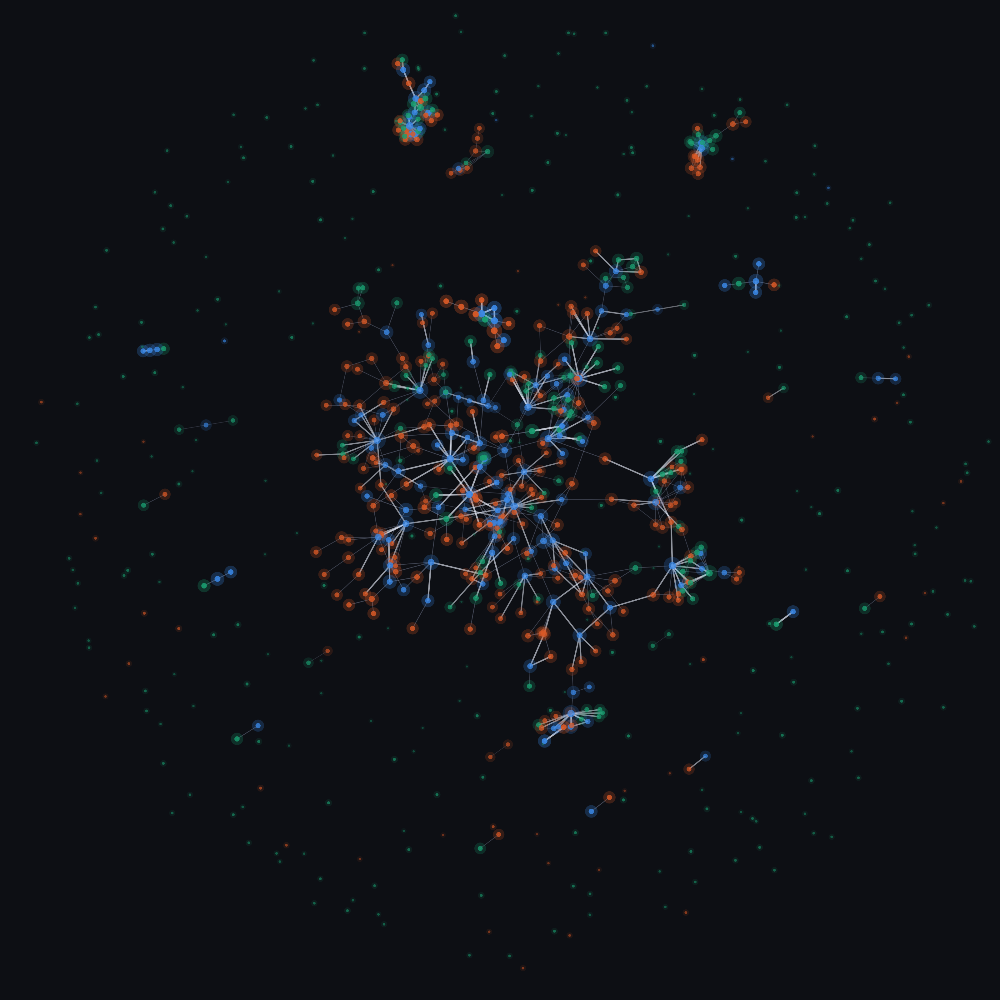

# 절차 그래프(Procedural Graph) — 할 일 순서 엔진

> 근거 논문: Lu, Chen, Wu, Arık. *Procedural Graphs: Self-Evolving Execution Structures for LLM Agents*. arXiv:2609.09153 (2026-09).
> 다람이에 맞게 읽고 가져온 것과 버린 것을 아래에 정리했다.

## 1. 논문 요약(검토 결과)

- **표현**: 지식 그래프가 (개체, 관계, 개체)로 "무엇인가"에 답하듯, 절차 그래프는 **(절차, 관계, 절차)** 삼중항으로 "다음에 무엇을 하나"에 답한다. 간선마다 텍스트 속성 **condition / guidance / pitfalls**(언제 적용되나 / 어떻게 진행하나 / 무엇을 피하나)를 붙인다. 관계 어휘는 LEADS_TO, TRIGGERS, PROVIDES_INPUT_FOR, CONVERGES_TO 네 가지(부록 B.4).
- **온라인 안내(3.2)**: 매 단계 에이전트의 **현재 노드를 찍고(localize)**, 그 노드의 2-hop 이웃 서브그래프만 꺼내(extract) 가이던스 LLM이 "다음에 할 것·피할 것"을 문장으로 만들어(generate) 솔버 프롬프트에 덧붙인다. 전체 그래프를 그대로 넣는 것보다 **국소 서브그래프**가 성능·토큰 모두 낫다(표 3: ALFWorld 54.5 → 81.5, 토큰 −70.9%).
- **오프라인 자기진화(3.3)**: 배치 실행 후 LLM 리파이너가 실패/성공 궤적을 대조해 노드·간선 추가/삭제를 제안 → **구조 검사**(끝점 존재, 순환 금지, 모든 노드가 종단에 도달) → **검증 집합 점수가 떨어지지 않으면 커밋** → 거절된 후보는 **rejection memory**로 다음 제안에 금지 목록으로 준다. 빈 뼈대(Start→End)에서 시작해도 사람이 만든 그래프와 맞먹거나 넘는다(표 2, Mode 5).
- **신뢰도**: 7개 벤치마크·4개 LLM에서 24설정 중 21개 1위. 단, 그래프가 7~17노드로 작고 과제가 "도구 호출 순서"라 우리 도메인(행정 절차 수백 개, 사용자가 실행)과 규모·주체가 다르다. 검증 집합 점수 게이트는 **자동 채점이 가능한 환경**이 전제다 — 다람이에는 그런 채점기가 없다.

## 2. 다람이에 적용한 것

| 논문 | 다람이 구현 |
|---|---|
| 노드 = 도구/행동 | 노드 = 행정 절차. 안정 키 `common:<id>` / `law:<이름>` / `svc:<service_id>` / `x:<이름>`(AI 제안) |
| 간선 (u, r, v) + Φ | `requires`(hard, 선행이 끝나야 가능 — 논문 PROVIDES_INPUT_FOR에 해당) / `suggests`(soft 순서 권고 — LEADS_TO). 속성 `condition/guidance/pitfalls` |
| 전문가 사전 그래프 | `sources/build_deps.py`의 EDGES(사람 작성) + `playbooks/kb_edges.json`(절차 지식베이스 조사에서 공식 페이지로 확인한 선행·후속, 근거 문장 포함) + 사전 생성 500건에서 관측된 간선·노드 메타 → **`playbooks/graph.base.json`** (806노드·639간선, hard 226, 순환 없음) |
| localize → 2-hop → 가이던스 | `graph.guidance_block(playbook, board)`: 보드의 완료 노드가 현재 위치. 플레이북 안 간선(1-hop)만 꺼내 "추천 순서 / 지금 할 수 있는 절차 / 막힌 절차와 이유(guidance) / 주의(pitfalls)"를 텍스트로 만들고 `/api/chat` 시스템 프롬프트에 넣는다. 문장 생성은 대화 LLM이 한다 |
| 자기진화(추가/삭제 제안) | `graph.learn()`: 플레이북에 **그래프 밖 새 절차**가 있을 때만 LLM에 간선 제안을 1회 요청(`prompts.GRAPH_EDGE_PROMPT`). 삭제 제안은 받지 않는다(사람 작성 EDGES가 정답) |
| 구조 검사 | `graph.validate()`: 끝점 존재·자기 간선·기존 간선/역방향 중복·순환·거절 이력 검사 |
| 검증 집합 게이트 | **없음**(채점기 부재). 대신 학습 결과를 **`playbooks/graph.learned.json`에만** 쓰고 기본판과 분리 → 언제든 삭제해 원복(`python -m sources.graph reset-learned`) |
| rejection memory | `graph.learned.json["rejected"]`: 거절된 (선행, 후속)과 이유. 다음 제안 프롬프트에 "제안 금지" 목록으로 들어가고 validate 도 막는다 |

### 우선순위(추천 순서) 규칙 — `graph.rank()` = 프론트 `lib/graph.ts`
위상 정렬(선행 → 후속)을 지키면서 같은 층에서는 **must → 응급 → 기한 짧은 것 → 여는 후속 수(unlocks) 많은 것** 순. 백엔드는 법정 기한(`deadlineDays`), 프론트는 페르소나 기준일로 환산한 실효 D-day를 쓴다. 각 절차에 `order`(1부터)·`unlocks`가 붙는다.

## 3. 전체 그림

`python -m sources.draw_graph [--views] [--gif] [--json]` 로 다시 그린다(networkx·matplotlib·numpy·scipy 필요 — 백엔드 venv 와 별도 환경).
실제 구조를 그대로 배치한다: 중심 = 거대 연결 성분(372노드, Kamada-Kawai 3D), 중간 = 작은 성분 25개(각각 힘 기반 구슬), 바깥 = 고립 노드 306개.
색 = 종류(파랑 법령·공통 / 초록 공공서비스 / 주황 AI 제안), 크기 = 차수, 간선은 requires 가 굵고 밝음. 글자 없음.

- `--gif` → `figure/procedural-graph-3d.gif`: 카메라가 한 바퀴 돌며 가까운 절차 이름이 떠오르는 README 용 애니메이션.
- `--json` → `graph/graph.json`: 같은 배치 좌표. **`graph/index.html`**(three.js, 의존성 CDN 하나)이 이걸 읽어 WebGL 로 그린다 — 자동 순회, 드래그·휠, 카메라에 가까운 절차만 이름 표시, 노드 클릭 시 선행·후속 절차 패널. GitHub Pages(`/docs`)로 그대로 서빙된다.

## 4. 파일·명령

| 파일 | 역할 |
|---|---|
| `playbooks/graph.base.json` | 기본판(생성물, 손대지 말 것). `python -m sources.build_graph` 로 재생성(EDGES 바꾸면 `build_deps` 먼저, 지식베이스 바꾸면 `kb_edges` 먼저) |
| `playbooks/procedures.json` | 절차 지식베이스(414건). 법령·공통·AI제안 절차의 창구·서류·수수료·기한·steps·pitfalls·sources·prerequisites/successors. 메인 에이전트가 정부24·생활법령·기관 페이지를 직접 확인해 작성(confidence verified 396 / partial 18 — partial 은 공식 페이지에 서류 목록이 없는 항목으로, 각 항목의 gap 필드에 사유 기록) |
| `playbooks/kb_edges.json` | `python -m sources.kb_edges` — 지식베이스의 선행·후속 이름을 노드 키로 해석한 간선 + 못 푼 이름(unresolved)·카탈로그와 방향이 다른 것(conflicts)·hard/soft 정정 요청(corrections) |
| `sources/kb.py` | `kb.enrich(proc)`: 키(또는 이름)로 지식베이스를 찾아 서류·링크·창구·기한·steps·pitfalls·출처를 덧입히고 verified 로 올린다. `curate_v2`·`curate` 결과와 `enrich_examples` 가 같은 함수를 쓴다 |
| `sources/enrich_examples.py` | 사전 생성 500건에 지식베이스를 반영하고 dependsOn·추천 순서를 기본판으로 다시 계산한다(재실행해도 결과 동일) |
| `playbooks/graph.learned.json` | 사용 중 확장(새 노드·채택 간선·거절 이력·출처 질문). **삭제해도 동작 동일** |
| `sources/graph.py` | 엔진: `apply`(dependsOn 채우기·hard 선행 자동 추가), `rank`, `guidance_block`, `learn/validate/commit`, CLI `stats / check / reset-learned / show <key>` |
| `sources/deps.py` | 예전 이름 호환 shim → graph 로 위임 |
| `GET /api/graph` | 기본판·학습판 현황(학습 간선 목록 포함) |
| `frontend/src/lib/graph.ts` | 보드 → DAG(layer/state/order/unlocks) |
| `frontend/src/lib/forceLayout.ts` · `components/GraphPopover.tsx` | 할 일 화면 오른쪽 아래 버튼 → 그래프 팝업(타원 안 힘 기반 배치, 노드 번호만·이름은 툴팁, 탭하면 상세) |

학습이 일어나는 지점: `curate_v2.curate_dynamic_v2` / `_curate_open` 끝. `generated/live/*.json` trace 의 `graph` 항목에 new_nodes / proposed / accepted / rejected 가 남는다.

### 안전장치: AI 제안 절차는 잠그지 않는다
`x:`(AI 제안, 미검증) 절차에서 나가는 간선은 `validate` 에서 hard 를 받지 않고, `apply` 에서도 `dependsOn`(체크 잠금) 대신 **`suggestedAfter`**(권고)로 들어간다. 프론트는 이를 가는 점선으로만 그리고 체크를 막지 않는다. 미검증 절차가 검증된 법정 절차를 막는 일을 방지하기 위한 규칙이다(스모크 테스트에서 "동호회 명의 변경 허가 → 이전등록"이 hard 로 제안된 사례가 계기).

## 5. 알려진 한계·다음 단계
- 학습 간선은 LLM 판단이라 틀릴 수 있다. 채점기가 생기면(예: `verify_playbooks` 를 검증 집합으로) 논문식 게이트를 넣을 자리는 `graph.learn()` 의 commit 직전이다.
- 학습 노드(`x:`)는 grounding 출처가 없어 hard 선행이어도 자동 추가는 하지 않는다(플레이북에 둘 다 있을 때만 연결).
- 간선 삭제·속성 수정 제안은 받지 않는다. 기본판을 고치려면 EDGES 를 고치고 재빌드한다.
